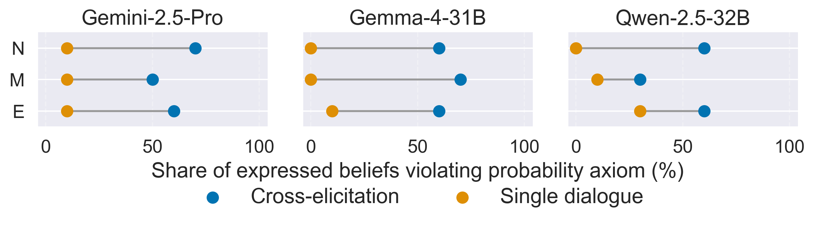
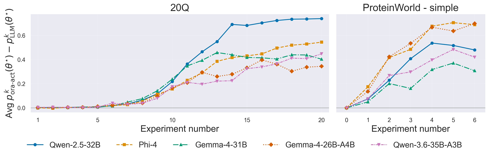
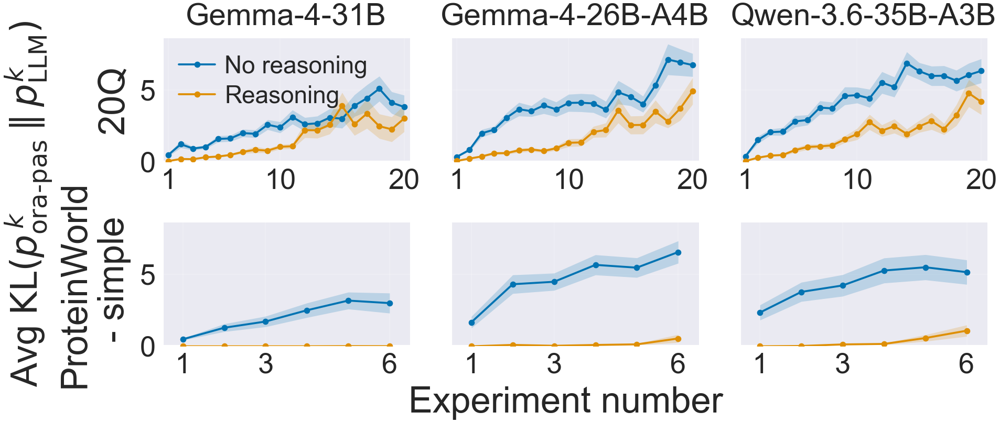
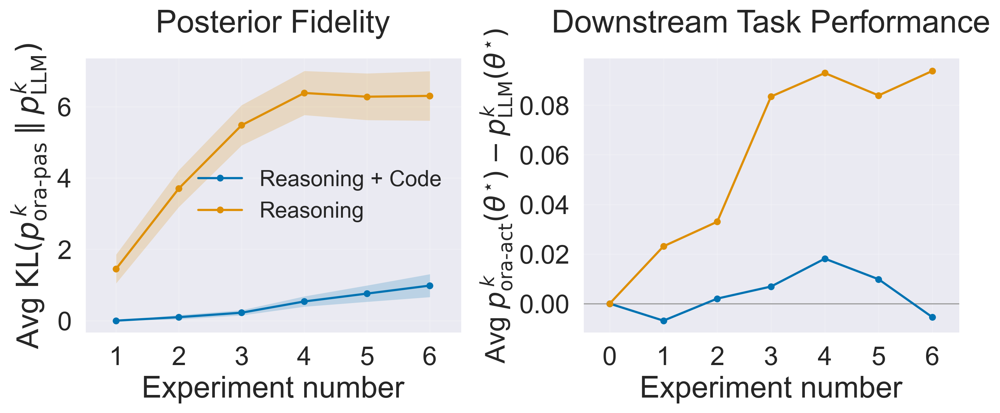
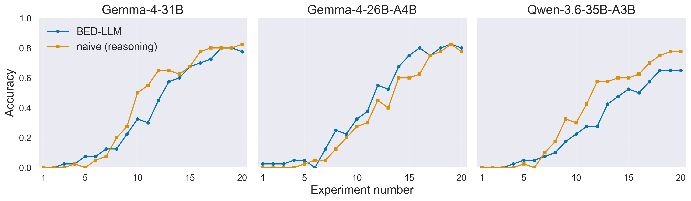

# From Prompts to Posteriors: Can LLM Agents perform Bayesian Inference in Context?

## Introduction

This repository contains the code for the three experiments presented in our work investigating the extent to which
current LLMs can perform Bayesian inference in context. We probe probabilistic coherence via Dutch Books, and assess
belief update quality and downstream task performance in mock scientific discovery scenarios via 20 Questions and
ProteinWorld.

## Main Results
Probability judgments by LLMs elicited across independent conversations
frequently admit Dutch Books, while eliciting the same judgments
within one dialogue removes most violations, suggesting that coherence
must be supplied by an explicitly maintained belief state rather than expected
to emerge across contexts.
<p align="center">
  <br>
</p>

Without reasoning, models fail to perform high quality Bayesian inference in
both 20Q and ProteinWorld, with severe consequences in downstream task
performance.
<p align="center">
  <br>
</p>

Native reasoning of modern open source models significantly improves those capabilities, yielding exact
closed-form posteriors and near-oracle downstream task performance for
ProteinWorld - simple, and coherent aggregation over sequences of up to
ten experiments in 20Q.
<p align="center">
  <br>
</p>

Access to code execution even enables oracle-like approximation of analytically 
intractable posteriors in ProteinWorld - hard.
<p align="center">
  <br>
</p>

Current belief-updating harnesses need to be re-evaluated, with modern
reasoning models being able to match their performance without any external
framework processing LLM outputs.
<p align="center">
  <br>
</p>


## Running the Project

`environment.yml` provides the interpreter and pip (`conda env update -f environment.yml`, or an equivalent 
`conda`/`mamba` invocation); every runtime dependency is pinned in `requirements.txt` and installed with 
`pip install -r requirements.txt`. `run.sbatch` performs both steps on every job. 

All experiments are 
launched through Slurm via `sbatch`. The entry point `main.py` takes a task name as its first positional 
argument, followed by any number of CLI overrides, and `run.sbatch` simply forwards its arguments to 
`main.py`:

```bash
sbatch run.sbatch twenty_questions
sbatch run.sbatch protein_world
sbatch run.sbatch dutch_books
```

Any argument not explicitly passed falls back to the corresponding task's `config.yaml`. The most important steps and 
results during each run are collected in `logs/logfile.txt`.

## CLI Arguments

### Common arguments

These apply to every experiment. Only `task` is required.

| Argument | Description                                                                                                                                                                                   | Example                         |
| --- |-----------------------------------------------------------------------------------------------------------------------------------------------------------------------------------------------|---------------------------------|
| `task` | !REQUIRED! Which task to run: `twenty_questions`, `protein_world`, or `dutch_books`.                                                                                                          | `sbatch run.sbatch dutch_books` |
| `--model`, `-m` | Which model to run, by its key in `model_registry.yaml`. Default: `Gemma-4-31B` without reasoning. Gemini models require exported GEMINI_API_KEY. Reasoning traces will be printed to stdout. | `--model gemma-4-31b-reasoning`  |
| `--seed` | RNG seed. Default: 42                                                                                                                                                                         | `--seed 7`                      |
| `--logfile` | Name for the log file, written to `logs/NAME.txt`. Default: `logfile` (`logs/logfile.txt`).                                                                             | `--logfile run_42`              |

### `twenty_questions`

| Argument | Description | Example |
| --- | --- | --- |
| `--method-names` | Which methods to run (`naive_eigreasoning`, `EIG`, `llm-driven`, `oracle-driven`). | `--method-names '[llm-driven, oracle-driven]'` |
| `--animals` | Determines the set of animals 20Q is performed with. | `--animals '[Coyote, Sand cat, Giraffe]'` |

### `protein_world`

| Argument | Description                                                                                                                                                                                                                                 | Example |
| --- |---------------------------------------------------------------------------------------------------------------------------------------------------------------------------------------------------------------------------------------------| --- |
| `--num-worlds-per-run` | How many random worlds to sample per run.                                                                                                                                                                                                   | `--num-worlds-per-run 5` |
| `--proteins-per-world` | How many proteins to classify per world.                                                                                                                                                                                                    | `--proteins-per-world 3` |
| `--num-protein-classes` | Number of available protein classes.                                                                                                                                                                                                        | `--num-protein-classes 8` |
| `--num-attr` | Number of latent attributes each protein is described by.                                                                                                                                                                                   | `--num-attr 8` |
| `--pre-req-list` | Per-attribute dependency list, defining which other attributes each attribute depends on. Length needs to be equal to the number of attributes.                                                                                             | `--pre-req-list '[[], [], [0], [1, 2]]'` |
| `--num-experiments` | Number of available experiments, all of which will be run.                                                                                                                                                                                  | `--num-experiments 3` |
| `--do-showcase-world` | Load the fixed showcase world (appendix example) instead of generating a random one; only supported for `exp_type` `simple` or `complex`.                                                                                                   | `--do-showcase-world` / `--no-do-showcase-world` |
| `--exp-type` | Experiment type: `simple` (independent attributes, exact reveal), `simple_noisy` (independent attributes, noisy reveal), `slightly_complex` (dependent attributes, noisy reveal), or `complex` (dependent attributes, complex experiments). | `--exp-type complex` |

### `dutch_books`

| Argument | Description | Example |
| --- | --- | --- |
| `--scenarios` | Which of the three Dutch Book scenarios to run: `normalization`, `monotonicity`, `extensionality`. | `--scenarios '[normalization, extensionality]'` |
| `--elicitation-modes` | Whether to elicit in the same (`same_chat`) or across (`separate_chat`) chats. | `--elicitation-modes '[same_chat, separate_chat]'` |

## Repository Structure

```
.
├── main.py                              # CLI entry point: parses arguments, builds config/model, dispatches to a task
├── models.py                            # LLM adapters (vLLM, Gemini) and the model registry loader/builder
├── helpers.py                           # Shared config base class and small utilities (logging, KL divergence, prob. normalization)
├── model_registry.yaml                  # Catalogue of available models: weights, provider, family, reasoning flag
├── environment.yml                      # Conda environment (interpreter + pip only)
├── requirements.txt                     # Pinned, mutually compatible runtime dependencies
├── run.sbatch                           # Slurm submission script
├── README.md                            
├── logs/                                # Runtime text logs
├── results-20Q/                         # Output directory for 20 Questions results
├── results-proteins/                    # Output directory for ProteinWorld results
│
├── twenty_questions/
│   ├── __init__.py                        
│   ├── config.py
│   ├── config.yaml                        # Default task configuration (methods, animals, ...)
│   ├── questions_game.py                  # Top-level game loops mirroring BED-LLM (BED-LLM and naive+reasoning)
│   ├── game_utils.py                      # Question answering, conversation-history handling, entropy helper
│   ├── generate_candidate_questions.py    # LLM-based candidate question generation and EIG-based selection
│   ├── sample_beliefs.py                  # Samples the model's current best guess from its belief set
│   ├── update_beliefs.py                  # Updates/filters the belief set after each question-answer pair
│   ├── classification.py                  # Top-level sequential Bayesian-updating evaluation loop (LLM-driven vs. oracle-driven)
│   └── prompts.py                         # Prompt templates used by the 20Q task
│
├── protein_world/
│   ├── __init__.py
│   ├── config.py
│   ├── config.yaml                        # Default task configuration (world size, attributes, experiment type, ...)
│   ├── classification.py                  # Top-level sequential Bayesian-updating evaluation loop (LLM-driven vs. oracle-driven)
│   ├── world_setup.py                     # Generates a fictional protein world: protein names, attributes, experiments
│   ├── showcase_world_setup.py            # Fixed example world used as showcase/appendix instance
│   ├── attribute.py                       # Protein attribute definitions, sampling, and dependency ordering
│   ├── experiment.py                      # Experiment definitions on various difficuly levelsand their outcome distributions
│   ├── experiment_selection.py            # Experiment selection strategies (EIG-based, random)
│   ├── probabilities.py                   # Elicits and parses the model's belief distribution over protein classes
│   └── prompts.py                         # Prompt templates used by the ProteinWorld task
│
└── dutch_books/
    ├── __init__.py
    ├── config.py
    ├── config.yaml                         # Default task configuration (which scenarios to run, model runtime)
    ├── dutch_book.py                       # Probability elicitation and response parsing for each scenario
    └── prompts.py                          # Scenario question sets and prompt templates
```
